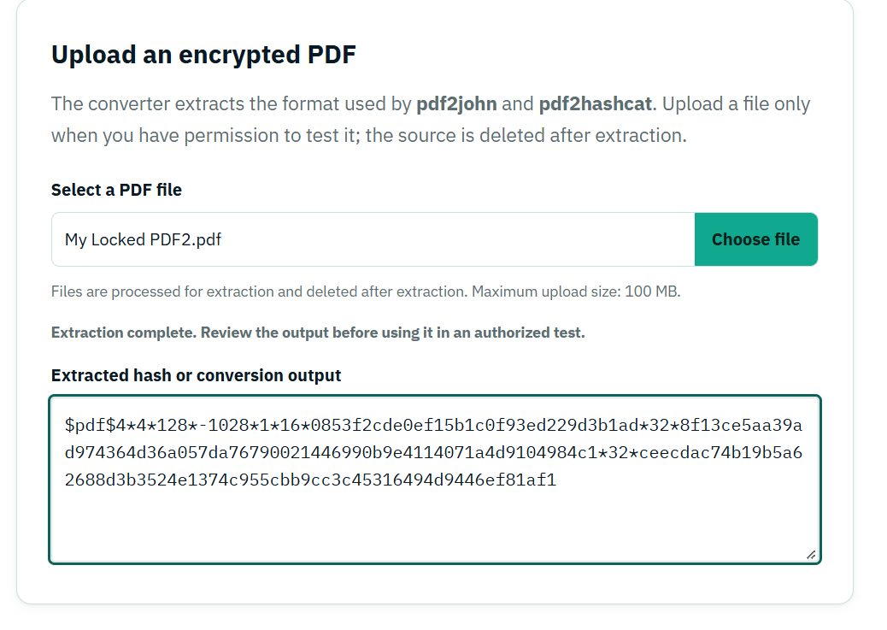
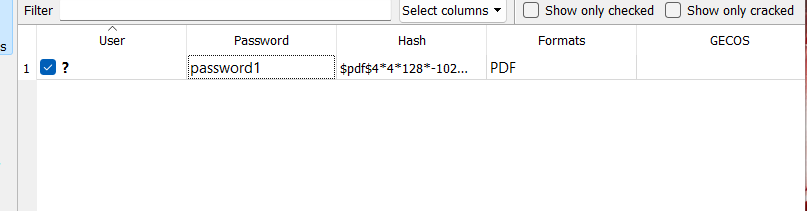
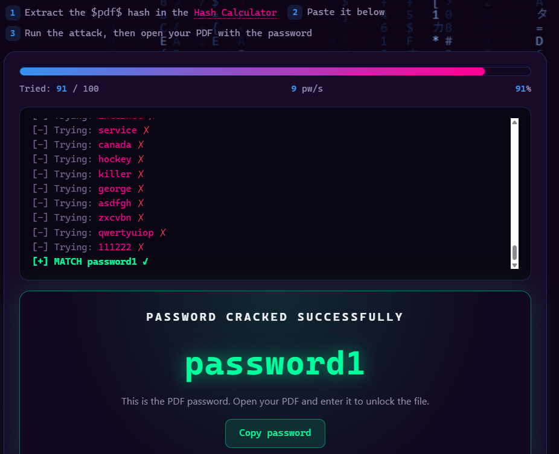
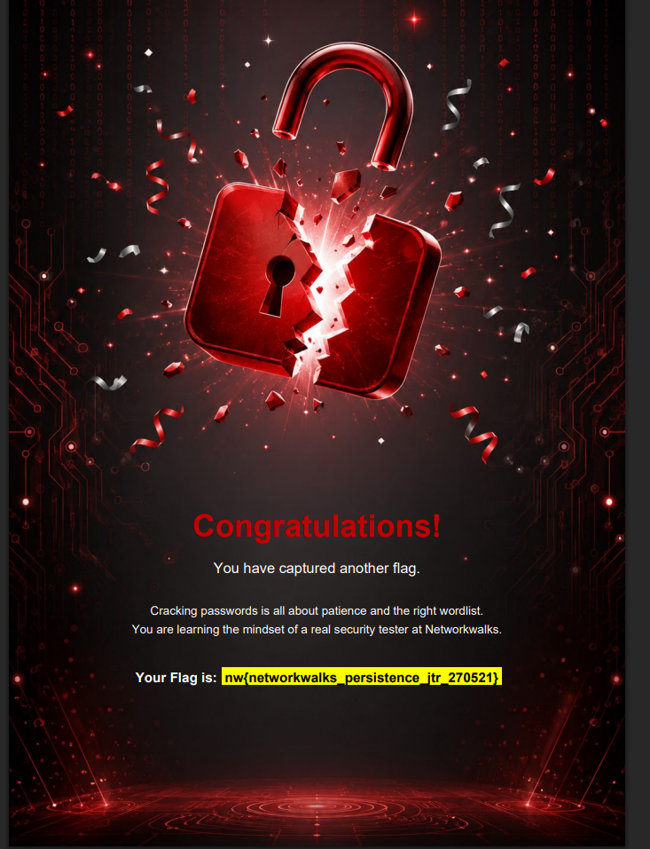

# networkwalks-w3-B083-password-cracking

Week 3 lab — cracking a password-protected PDF using John the Ripper/Johnny and Networkwalks online tools.

# Week 3 Project Report — Password Cracking with JTR and Networkwalks Tools

**W3-PM1 | W3-PM2 | CYBERSECURITY | NETWORKWALKS**

| Field | Details |
|---|---|
| Pentester Name | Krrish Pravin Mukadam |
| Program / Batch | B084 - Networkwalks |
| Date | 20 November 2026 |
| Modules completed | W3-PM1 (Password Cracking with JTR) |
| | W3-PM2 (Password Cracking with Networkwalks Tools) |
| Target File | My Locked PDF2.pdf |
| Permission secured from client? | Yes — file provided for lab exercise |
| Phases covered | Phase 1: Hash Extraction |
| | Phase 2: Password Cracking (Local Tool) |
| | Phase 3: Password Cracking (Online Tool) |

## 1. Liability Disclaimer

I have performed these activities only on the files provided for this lab exercise, for education and research purposes only. Do not use anything from here to break the law. The instructor, the authors, and Networkwalks are not responsible for what you do with this knowledge. Every action you take is your own responsibility.

## 2. Methodology

This exercise was carried out using two separate approaches to recover the password of an encrypted PDF file:

1. **John the Ripper (JTR) + Johnny GUI** — a locally installed password-cracking suite.
2. **Networkwalks Hash Calculator + Password Cracker** — free browser-based tools requiring no installation.

Every step below includes:
- The exact tool or command used.
- The result observed.
- A screenshot as evidence.
- A short note on why the finding matters from a security perspective.

## 3. Tools Used

| Tool | Purpose |
|---|---|
| John the Ripper (JTR) | Command-line password-cracking tool; recovers passwords from file hashes |
| Johnny | GUI front-end for John the Ripper, for point-and-click password attacks |
| Networkwalks Hash Calculator | Browser-based tool to extract the password hash from a locked PDF |
| Networkwalks Password Cracker | Browser-based tool to crack a password from an extracted hash |
| Windows 11 | Host OS used to run the local and browser-based tools |
| Kali Linux | Linux environment for cybersecurity testing |

## 4. Background

Password cracking is the process of recovering a password from stored data or a protected file. Security professionals use it to test password strength and demonstrate why weak passwords are a risk — a short or common password can be recovered quickly, while a strong one resists cracking for far longer.

Files such as PDF, ZIP, and Office documents use password-protection mechanisms that allow password candidates to be tested against extracted hash data. A hash is a representation of password-related data used by the verification process. To recover the original password, the hash must first be extracted from the file, then run through a cracking tool that tests candidate passwords from a wordlist or other supported attack mode.

---

## 5. Module 1 — Password Cracking with JTR (John the Ripper + Johnny)

### 5.1 Task

Crack the password of the supplied PDF file (`My Locked PDF2.pdf`) using **John the Ripper** and the **Johnny** GUI.

> Note: On Kali Linux, John the Ripper can be installed using the package manager. Some Kali installations may already have it installed.

### 5.2 Installation

| Step | Action | Result |
|---|---|---|
| 1 | Downloaded John the Ripper from the official site (openwall.com/john) | JTR binaries obtained for Windows |
| 2 | Downloaded Johnny GUI from openwall.info/wiki/john/johnny | Installer obtained |
| 3 | Ran the Johnny setup file | Johnny installed successfully |
| 4 | Opened Johnny → Settings → Browse | Pointed Johnny to `john.exe` |
| 5 | Located `john.exe` in the `run` folder of the JTR download | Johnny linked to the John the Ripper engine |

### 5.3 Hash Extraction

| Step | Action | Result |
|---|---|---|
| 1 | Downloaded the encrypted file `My Locked PDF2.pdf` | File saved locally |
| 2 | Uploaded the PDF to the Networkwalks Hash Calculator | Hash value generated, prefixed `$pdf$...` |
| 3 | Copied the hash value | Complete hash copied |
| 4 | Saved the extracted hash for local testing | Hash ready for JTR |

> **Note:** The hash must be saved in the exact format the extractor outputs, starting with `$pdf$`. Any additional characters can cause John the Ripper to fail to parse the hash.

**Screenshot – PDF Hash Extraction**



### 5.4 Cracking the Password

| Step | Action | Result |
|---|---|---|
| 1 | Opened Johnny | GUI launched |
| 2 | Clicked "Open password file" and selected the extracted hash file | Hash loaded into Johnny |
| 3 | Clicked "Start new attack" | John the Ripper began testing candidate passwords |
| 4 | Waited for the attack to complete | Password successfully cracked |
| 5 | Observed the password in the result table | Password recovered successfully |

**Screenshot – Johnny Password Cracking Result**



### 5.5 Observation

John the Ripper successfully recovered the PDF password as `password1`.

The screenshot shows the recovered password in the Johnny result table. This demonstrates that a weak or dictionary-based password can be recovered when it is included among the tested candidates.

---

## 6. Module 2 — Password Cracking with Networkwalks Tools

### 6.1 Task

Crack the password of the same PDF file (`My Locked PDF2.pdf`) using the **Networkwalks Hash Calculator** and **Networkwalks Password Cracker** — both free, browser-based tools requiring no local software installation.

> Note: This method also works on Kali Linux, since both tools run entirely in a web browser.

### 6.2 Steps

| Step | Action | Tool / URL |
|---|---|---|
| 1 | Downloaded the encrypted PDF from the lab page | networkwalks.com |
| 2 | Opened the Networkwalks Hash Calculator | networkwalks.com/hash-calculator |
| 3 | Uploaded the locked PDF file | Tool extracted the hash, prefixed `$pdf$...` |
| 4 | Copied the complete hash value | Confirmed the full string was copied |
| 5 | Opened the Networkwalks Password Cracker | networkwalks.com/password-cracker |
| 6 | Pasted the hash and started the attack | Tool began testing candidate passwords |
| 7 | Waited for the attack to complete | Cracked password displayed on screen |
| 8 | Verified the recovered password | Password match confirmed |

**Screenshot – Networkwalks Hash Calculator**


**Screenshot – Networkwalks Password Cracker**



### 6.3 Observation

The Networkwalks online tools successfully identified the password `password1` from the extracted PDF hash.

The cracking interface showed:
- Total candidates: 100
- Candidates tried: 91
- Successful match: `password1`
- Status: Password cracked successfully.

This shows that password cracking is accessible even without specialist local tooling. Browser-based cracking services lower the barrier further, meaning weak document passwords can be broken by anyone with access to the hash and a suitable cracking service.

### 6.4 Flag Capture

After successfully cracking the PDF password, the lab displayed a congratulations message confirming successful flag capture.

**First Flag Captured**


**Additional Persistence Flag**



These screenshots provide evidence of successful completion of the Networkwalks lab activities.

---

## 7. Comparison of Methods

| Aspect | JTR + Johnny (Local) | Networkwalks (Online) |
|---|---|---|
| Installation required | Yes | No |
| Runs offline | Yes | No — requires internet access |
| Platform | Windows / Linux / Mac | Any device with a browser |
| Ease of use for beginners | Moderate (GUI simplifies this) | High (fully guided, no setup) |
| Data privacy | Hash stays local | Hash uploaded to third-party service |

## Evidence Collected

**Screenshot (179) – Johnny JTR Password Cracking**


**Screenshot (181) – First Flag Captured**


**Screenshot (183) – PDF Hash Extraction**


**Screenshot (184) – Online Password Cracker**


**Screenshot (185) – Additional Persistence Flag**


---

## 8. Key Takeaways

- Both a locally installed tool and a free online tool were able to recover the same password from the same hash, showing that **password strength, not tool availability, is the real defense**.
- Uploading a hash to an online cracking service means the hash leaves your machine; for real engagements, this is **not appropriate for sensitive or confidential client data**. Local tools like JTR should be preferred.
- John the Ripper and Johnny provide a useful local password-auditing solution.
- Networkwalks online tools provide a simple browser-based alternative for authorized lab exercises.
- This exercise reinforces why organizations should use long, random passphrases and file-level encryption combined with strong access controls rather than relying on weak password protection.

---

## 9. Repository Structure

```text
networkwalks-w3-B083-password-cracking/
│
├── README.md
│
└── screenshots/
    ├── 01-online-password-cracker.png
    ├── 02-pdf-flag-1.png
    ├── 03-pdf-hash-extraction.png
    ├── 04-pdf-persistence-flag.png
    └── 05-johnny-jtr-result.png
```

---

**Pentesting Project Report | Networkwalks | Krrish Pravin Mukamad**
